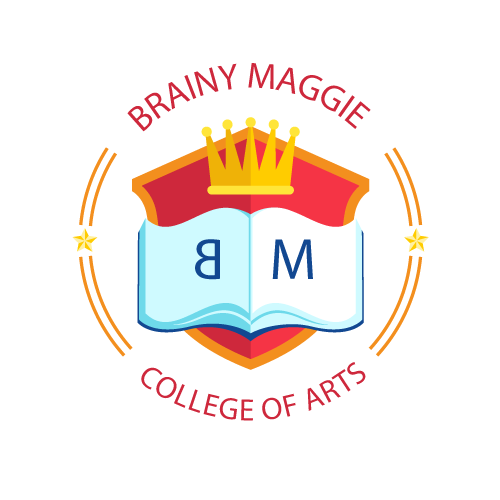

# Brainy Maggie College of Arts
## School Management System



A Java command-line application for managing university students, courses, enrolments, grades, and overall course performance.

## Project Overview

This project demonstrates:

- Object-oriented programming (OOP) in Java
- Encapsulation using private fields and public methods
- Instance variables and instance methods
- Static variables and static methods
- Collections such as `ArrayList`, `LinkedHashMap`, and `Map`
- Input validation and exception handling
- Course capacity management
- Student enrolment and grade assignment
- Calculation of overall grades
- A menu-driven administrator interface

## Main Classes

### `Student.java`
Represents a student.

Important fields and methods:

- `name` and `studentId`: private student information
- `enrolledCourses`: stores courses and their grades for that student
- `getName()` / `setName()`
- `getStudentId()` / `setStudentId()`
- `enrollInCourse(Course course)`
- `assignGrade(Course course, double grade)`
- `getEnrolledCourses()`
- `getGrade(Course course)`

### `Course.java`
Represents a university course.

Important fields and methods:

- `courseCode`
- `courseName`
- `maximumCapacity`
- static `totalEnrolledStudents`
- `getCourseCode()`
- `getCourseName()`
- `getMaximumCapacity()`
- static `getTotalEnrolledStudents()`

The static variable belongs to the `Course` class rather than to one individual course. Therefore, successful enrolments are counted across all course objects.

### `CourseManagement.java`
Provides shared management operations using static fields and methods.

Static collections include:

- `courses`: the course catalogue
- `overallCourseGrades`: stores each student's calculated overall grade
- `students`: the registered students
- `courseEnrolmentCounts`: tracks enrolments for each course so capacity can be enforced

Main methods:

- `addCourse(...)`
- `addStudent(...)`
- `enrollStudent(...)`
- `assignGrade(...)`
- `calculateOverallGrade(...)`
- `findStudent(...)`
- `findCourse(...)`

### `AdministratorInterface.java`
Provides the interactive command-line interface.

The administrator can:

1. Register a student
2. Add a new course
3. Enrol a student in a course
4. Assign a grade
5. Calculate an overall grade
6. List students
7. List courses
8. View total enrolments
9. Exit the application

### `Main.java`
Starts the application by creating the administrator interface and calling `start()`.

## How Static Members Are Used

The assignment specifically requires static members to demonstrate information shared across multiple objects.

### Static course enrolment counter

`Course` contains:

```java
private static int totalEnrolledStudents = 0;
```

Every successful enrolment increases this shared value. It can be retrieved using:

```java
Course.getTotalEnrolledStudents();
```

This means the value is shared by every `Course` instance.

### Static course and grade management

`CourseManagement` uses static collections because the application has one shared course catalogue and one shared set of students/overall grades.

For example:

```java
private static final List<Course> courses = new ArrayList<>();
private static final Map<Student, Double> overallCourseGrades = new LinkedHashMap<>();
```

The application therefore demonstrates the difference between:

- **Instance state**: information belonging to one student or one course.
- **Static state**: information shared by the entire application/class.

## Overall Grade Calculation

The overall grade is calculated as the arithmetic mean of all grades that have been assigned to the student.

Example:

- Java Programming = 80
- Database Systems = 70
- Networking = 90

Overall grade:

```text
(80 + 70 + 90) / 3 = 80.00%
```

Courses where a grade has not yet been assigned are excluded from the calculation.

## Error Handling

The application handles common invalid conditions, including:

- Empty student names or IDs
- Duplicate student IDs
- Duplicate course codes
- Invalid course capacities
- Grades below 0 or above 100
- Students that do not exist
- Courses that do not exist
- Students attempting to enrol in the same course twice
- Courses that have reached maximum capacity
- Assigning a grade to a course in which a student is not enrolled
- Invalid numeric input in the administrator menu

## Requirements

- Java Development Kit (JDK) 17 or later is recommended.
- A terminal/command prompt.
- Git and GitHub for version control.

The program uses standard Java libraries only. No external dependencies are required.

## Running the Project

Open a terminal in the project directory.

### 1. Compile

Windows PowerShell:

```powershell
javac -d out src/*.java
```

Linux/macOS:

```bash
javac -d out src/*.java
```

### 2. Run

Windows PowerShell:

```powershell
java -cp out Main
```

Linux/macOS:

```bash
java -cp out Main
```

## Example Workflow

```text
1. Register Student
   Name: Susan Maina
   ID: BM001

2. Add New Course
   Code: CS101
   Name: Introduction to Java
   Capacity: 30

3. Enrol Student in Course
   Student ID: BM001
   Course Code: CS101

4. Assign Grade
   Student ID: BM001
   Course Code: CS101
   Grade: 85

5. Calculate Overall Grade
   Overall grade: 85.00%
```

## Suggested GitHub Repository Structure

```text
School-Management-System/
├── assets/
│   └── logo.png
├── src/
│   ├── AdministratorInterface.java
│   ├── Course.java
│   ├── CourseManagement.java
│   ├── Main.java
│   └── Student.java
├── .gitignore
└── README.md
```

## Learning Outcomes

This project demonstrates practical use of Java OOP concepts, especially encapsulation, object state, instance behaviour, static members, collections, exception handling, and command-line interaction.

## Author

Susan Maina

Java / Software Engineering Portfolio Project
